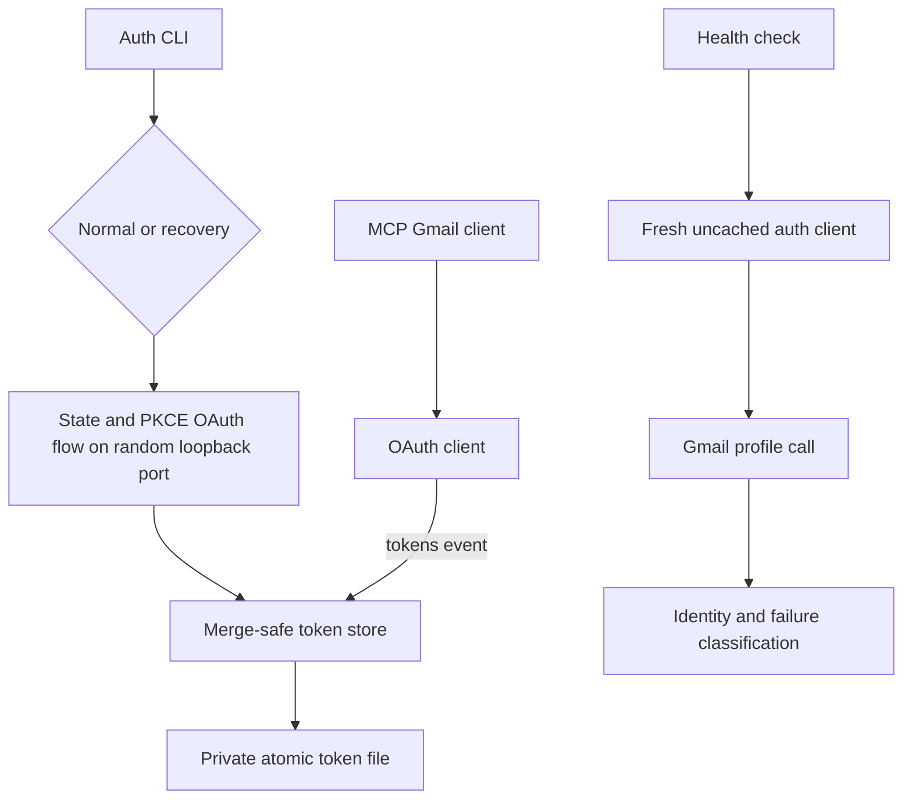

# Gmail OAuth Authentication Hardening - Plan

## Goal Capsule

- **Objective:** Make normal multi-account Gmail operation silent and durable while preserving an explicit, secure recovery path when Google requires human authorization.
- **Authority:** User-settled production OAuth posture and five-account support override implementation convenience. Official Google OAuth behavior overrides any promise that consent can be bypassed forever.
- **Execution profile:** Security-sensitive TypeScript change with automated tests, continuous integration, and an opt-in live five-account verification.
- **Stop conditions:** Stop if the implementation would expose tokens, weaken Google security controls, force routine consent, or require committing local account configuration.
- **Tail ownership:** The implementing agent owns code, tests, documentation, CI, pull request, and proof that no secrets entered the diff. Host scheduling and macOS Keychain migration remain separate follow-up work.

---

## Product Contract

### Summary

Replace forced-consent authorization and file-only status reporting with a secure normal/recovery split, durable token persistence, hardened loopback OAuth, and a real Gmail health check for every configured account.

### Problem Frame

The current CLI always adds `prompt=consent`, so every manual authorization forces Google’s permission screen. Token refresh responses are written over the stored token, even though Google can omit the refresh token in later responses. Direct writes can corrupt token JSON and inherit unsafe file permissions. The callback flow has no state validation or PKCE, and its timer can keep the process alive after success. The current `--check` command only inspects local JSON and can report an account as healthy without proving refreshability or Gmail access.

The OAuth application is now External and In Production. All five configured accounts have working refresh tokens. The code must preserve that healthy state and clearly identify the smaller set of cases where Google still requires a person to sign in again.

### Actors

- A1. Operator running normal authorization for one account or all configured accounts.
- A2. Operator deliberately recovering a missing or revoked refresh token.
- A3. Agent or scheduler running the noninteractive health check.
- A4. Gmail MCP server using stored credentials during normal tool calls.
- A5. Google OAuth and Gmail APIs enforcing consent, token, account, and policy rules.

### Requirements

**Normal and recovery authorization**

- R1. Normal authorization must omit `prompt=consent`; only an explicit `--force-consent` recovery request may force Google’s consent screen.
- R2. Normal authorization must support one selected account and all configured accounts; forced-consent recovery must require one explicit account alias.
- R3. The loopback flow must use cryptographic state validation, PKCE S256, an exact callback path, a random loopback-only port, and one terminal completion path.
- R4. Authorization must close its server and clear its timeout after success, denial, validation error, server error, or timeout.
- R5. A normal authorization response that lacks a refresh token must preserve the valid stored refresh token or fail with a clear `--force-consent` recovery instruction.

**Token durability and security**

- R6. Every token update must merge over the latest stored credentials so omitted fields do not erase durable credentials and a rotated refresh token replaces the old one.
- R7. Token writes must use a private directory, a private temporary file, and atomic replacement; failed writes must not corrupt the last good token.
- R8. Existing token and OAuth credential files encountered by the program must be repaired to owner-only permissions where the operating system supports POSIX modes.
- R9. Automatic refresh events emitted during Gmail use must persist synchronously and fail closed through the same merge-safe token store without logging credentials.

**Truthful health and operations**

- R10. `npm run auth:check` must force a refresh-token exchange before calling Gmail for every configured account without using the stored access token or normal client cache.
- R11. The health check must verify that Gmail’s returned address matches the configured account and must report every account before returning nonzero if any fail.
- R12. Health output must distinguish reauthorization-required failures from Gmail scope, policy, quota, wrong-account, corrupt-token, and local permission failures.
- R13. Normal MCP authentication errors must not teach users that every HTTP 403 requires reauthorization.

**Least privilege, documentation, and delivery**

- R14. This stability fix must preserve the current requested scopes and document a separate one-time least-privilege migration instead of implying that a code-only scope change retracts existing grants.
- R15. Documentation must explain In Production setup, normal versus forced recovery, live check behavior, token protection, and unavoidable human reauthorization cases.
- R16. Automated tests and CI must cover security, refresh-token preservation, callback cleanup, CLI behavior, and health classification without requiring real credentials.
- R17. Live verification must be opt-in and use ignored local credentials, account configuration, and tokens; no secret or token value may appear in logs, fixtures, commits, or the pull request.
- R18. Account configuration must reject duplicate aliases and any alias whose canonical token path is not a direct child of the token directory before filesystem access occurs.

### Key Flows

- F1. Normal authorization
  - **Trigger:** A1 runs auth for one account or all accounts.
  - **Steps:** Reuse a proven healthy token without opening a browser. When authorization is needed, build a state-bound PKCE URL without a prompt override on a random loopback port, receive the exact callback, exchange the code, verify the Gmail address, merge tokens, save privately, and close the server.
  - **Outcome:** The account remains authorized without unnecessarily forcing consent.
  - **Covered by:** R1, R2, R3, R4, R5, R6, R7, R8
- F2. Explicit recovery authorization
  - **Trigger:** A2 runs auth with `--force-consent` after the health check reports reauthorization required.
  - **Steps:** Require one explicit account alias, use the same hardened flow with `prompt=consent`, verify the Gmail address, accept a new refresh token, merge and save it, then close cleanly.
  - **Outcome:** Human consent occurs only because the operator deliberately requested recovery.
  - **Covered by:** R1, R2, R3, R4, R6, R7
- F3. Automatic refresh during MCP use
  - **Trigger:** A4 makes a Gmail call with an expiring or expired access token.
  - **Steps:** Google refreshes credentials, emits tokens, and the token store merges and atomically persists the update.
  - **Outcome:** Normal Gmail use continues and the refresh token cannot be erased by an omitted field.
  - **Covered by:** R6, R7, R8, R9, R13
- F4. Noninteractive health check
  - **Trigger:** A3 runs `npm run auth:check` manually or from a scheduler.
  - **Steps:** Inspect and repair local token protection, construct credentials from the stored refresh token without reusing the access token, force an exchange, call Gmail profile, compare account identity, classify failures, and continue across all accounts.
  - **Outcome:** Exit zero only when every configured account has proven Gmail access.
  - **Covered by:** R8, R10, R11, R12, R17

### Acceptance Examples

- AE1. Given a healthy stored token, when normal auth runs, then Gmail profile succeeds, no browser opens, and no consent prompt is requested.
- AE2. Given a revoked refresh token, when the health check receives `invalid_grant`, then it reports reauthorization required, checks the remaining accounts, and exits nonzero.
- AE3. Given a callback with a missing or mismatched state, when it reaches the loopback server, then no token exchange or token write occurs and the server closes.
- AE4. Given an existing token file with mode `0644`, when the token store reads or updates it, then the file becomes `0600` without changing credential values.
- AE5. Given a valid token for a different Google account, when the health check reads the Gmail profile, then it reports a wrong-account failure and exits nonzero.
- AE6. Given a Gmail 403 policy or scope response, when a tool or health check handles it, then the output preserves the category and does not claim that consent recovery is the universal fix.
- AE7. Given a successful OAuth exchange for the wrong Google account, when Gmail profile returns a different address, then no new token is saved and the previous token remains untouched.

### Success Criteria

- Routine auth and health commands never add forced consent unless `--force-consent` was supplied.
- Token-store tests prove refresh-token retention, token rotation, atomic replacement, and owner-only permissions.
- OAuth-flow tests prove state, PKCE, callback-path validation, timeout cleanup, and exactly-once server shutdown.
- Health tests prove all-account reporting, account-identity checks, actionable failure classes, and aggregate nonzero status.
- Typecheck, tests, build, and CI pass with no real credentials.
- An opt-in live run reports all five configured accounts healthy and all token files owner-only.

### Scope Boundaries

**Included now**

- Cross-platform atomic token-file storage, with owner-only file permissions enforced where POSIX modes are supported; hardened installed-app OAuth, real health checks, tests, documentation, and CI.
- Preserving the current grant request during the stability repair.

**Deferred to follow-up work**

- macOS Keychain storage. A platform-specific secret backend requires an explicit migration and cross-platform fallback contract.
- A daily `launchd` schedule and Life OS fail-closed source-access gate. This repository first needs a reliable noninteractive command for those host integrations to call.
- Separate Internal Workspace and External consumer OAuth clients. The production External client supports the current five-account set without duplicating configuration.
- A true least-privilege migration to `gmail.modify`. Existing grants must be audited and deliberately revoked/regranted; changing the requested scope or enabling incremental authorization alone does not retract them.

**Outside this change**

- Domain-Wide Delegation or any service account that can impersonate Workspace users.
- Bypassing Google’s consent, account security, revocation, password-change, scope-change, or administrator controls.
- Slack connector repair or unrelated Life OS integrations.

---

## Planning Contract

### Key Technical Decisions

- KTD1. Keep the OAuth application External and In Production. (session-settled: user-approved — chosen over Testing/test-user mode: Testing caused seven-day Gmail refresh-token expiry.)
- KTD2. Preserve support for all five configured accounts. (session-settled: user-directed — chosen over a primary-account subset: key source accounts must be live before meaningful Life OS work.)
- KTD3. Normal auth omits `prompt`; only `--force-consent` adds `prompt=consent`. Google documents that forced consent is how a new refresh token is deliberately requested, not a routine requirement.
- KTD4. Preserve the current scope request in this repair. A real downscope requires an explicit revoke-and-regrant migration, while `include_granted_scopes=true` can retain earlier grants and would make a code-only change misleading.
- KTD5. Use state plus PKCE S256 even on the desktop loopback flow. State prevents callback request substitution, while PKCE binds the authorization code to this process.
- KTD6. Centralize disk behavior in a token-store module. Both explicit authorization and automatic token events must share the same merge, permission, atomic-write, and error rules.
- KTD7. Use a dependency-free per-account cross-process lock around latest-read, merge, durable temporary write, and atomic rename. Bounded waiting and stale-lock recovery prevent a running MCP process from restoring an old refresh token after recovery rotates it.
- KTD8. Treat a forced refresh-token exchange followed by a Gmail profile request as the health proof. File presence, local expiry, and a still-valid access token are not evidence that future refresh and Gmail access work.
- KTD9. Verify Gmail’s returned address against the configured address before saving authorization results. `login_hint` guides account selection but does not enforce identity.
- KTD10. Use Node’s built-in test runner through `tsx --test`. The repository already depends on `tsx`, so coverage can be added without a new test framework.
- KTD11. Bind the callback server to `127.0.0.1` on an operating-system-selected port. This avoids broad binding and fixed-port collisions while staying inside Google’s supported desktop loopback flow.
- KTD12. Forced-consent recovery requires one explicit account. This limits accidental mass reauthorization and makes each human recovery intentional.

### Assumptions

- The existing desktop OAuth credential supports random-port loopback redirects, as documented for installed applications.
- POSIX permission assertions are skipped or adapted on platforms that do not expose Unix file modes.
- CI has no Gmail credentials, account configuration, or Gmail tokens. GitHub’s workflow token remains a trust boundary and must be constrained to read-only repository access.
- The five-account live check is a local release verification, not a CI job.

### High-Level Technical Design

The token store is the single persistence boundary. The OAuth flow owns temporary callback state and clean shutdown. The health check creates fresh clients so the existing 50-minute Gmail client cache cannot hide broken disk credentials.

### System-Wide Impact

- **MCP runtime:** Automatic refresh persistence changes from a one-time preflight write to a token-event listener shared with explicit auth.
- **CLI contract:** `--check` becomes asynchronous and truthful. `--force-consent` is an explicit recovery modifier that requires one account alias.
- **Error contract:** Auth failures become classified outcomes. Existing 401/403 handling must preserve provider details and avoid false recovery advice.
- **Persistent state:** Existing token JSON remains compatible. Reading or updating a token repairs permissions but does not migrate, revoke, or downscope credentials.
- **Security boundary:** Callback validation and token storage are hardened without creating a path around Google’s human-only security controls.
- **Agent parity:** Agents and schedulers may run the health check, but OAuth consent remains human-only.

### Risks and Mitigations

- **Loss of a refresh token during a race:** Hold a per-account cross-process lock across latest-read, merge, durable write, and rename; bound lock waiting and recover stale locks.
- **Callback collision or bind failure:** Ask the operating system for an unused loopback port, report listener errors clearly, close exactly once, and never fall through to a dangling timer.
- **False health from cached clients:** Build fresh auth and Gmail clients inside the health path.
- **Scope expectation drift:** Keep the current request unchanged and document why true least-privilege migration is separate.
- **Platform permission differences:** Enforce `0700`/`0600` on POSIX systems and avoid claiming equivalent mode semantics on unsupported platforms.
- **Secret exposure during live validation:** Log account aliases and result classes only. Never print token bodies or credential JSON.
- **Upstream portability:** Keep Keychain and host scheduling out of the core patch until their migration and fallback behavior are designed.

### Sources

- Google Auth Library for Node.js: authorization URL options, PKCE token exchange, and token events: <https://github.com/googleapis/google-auth-library-nodejs>
- Google OAuth 2.0: refresh-token behavior and unavoidable reauthorization conditions: <https://developers.google.com/identity/protocols/oauth2>
- Google OAuth security best practices: <https://developers.google.com/identity/protocols/oauth2/resources/best-practices>
- Gmail authorization scopes: <https://developers.google.com/workspace/gmail/api/auth/scopes>
- Repository implementation: `src/gmail/auth.ts`, `src/auth.ts`, `src/gmail/client.ts`, `src/gmail/types.ts`, `src/config.ts`

---

## Implementation Units

### U1. Add the secure token-store boundary

- **Goal:** Make every credential update merge-safe, atomic, private, and safe across concurrent local processes.
- **Requirements:** R5, R6, R7, R8, R9, R18
- **Files:** `src/config.ts`, `src/gmail/token-store.ts`, `src/gmail/types.ts`, `test/config.test.ts`, `test/token-store.test.ts`
- **Approach:** Validate aliases and token-path containment before filesystem access. Normalize the stored credential shape around optional OAuth fields. Hold a bounded per-account cross-process lock while reading the latest token, merging returned values, preserving an omitted refresh token, durably writing a unique private temporary file, atomically replacing the target, and cleaning up failed writes. Recover only locks proven stale.
- **Test scenarios:** Reject duplicate and path-traversal aliases; preserve an omitted refresh token; accept a rotated refresh token; prevent a stale concurrent writer from restoring an old refresh token; bound lock waiting and recover a stale lock; repair an insecure mode; keep the last good token after a simulated failed replacement; reject malformed JSON without logging it.
- **Verification:** The token-store test suite passes on supported platforms and the diff contains no credential values.

### U2. Harden normal and recovery OAuth flows

- **Goal:** Remove routine forced consent and secure the loopback authorization lifecycle.
- **Requirements:** R1, R2, R3, R4, R5, R6, R7, R8
- **Files:** `src/gmail/auth.ts`, `src/auth.ts`, `test/auth-flow.test.ts`, `test/auth-cli.test.ts`
- **Dependencies:** U1
- **Approach:** Repair `credentials.json` to owner-only mode before loading it. Define recovery as `npm run auth -- <alias> --force-consent` and reject forced consent without exactly one alias. Silently accept a healthy existing account; generate state and a PKCE verifier/challenge; listen on a random loopback port before constructing the redirect-bound URL; constrain the callback; verify Gmail identity before saving; handle provider errors; protect every completion path with one cleanup function; and save through the token store.
- **Test scenarios:** Repair an insecure OAuth credential file; healthy normal auth opens no browser; a missing-token normal URL omits prompt; the canonical one-account recovery form includes consent; forced consent without exactly one alias is rejected; state and PKCE are present; wrong-account, denial, and mismatched state cannot mutate tokens; success, timeout, callback error, and server error close once and clear the timer.
- **Verification:** Authorization-flow and CLI tests prove F1, F2, AE1, and AE3 without opening a real browser.

### U3. Persist automatic refresh and improve runtime auth errors

- **Goal:** Keep tokens durable during normal MCP traffic and stop treating every 403 as revoked authorization.
- **Requirements:** R6, R8, R9, R13
- **Files:** `src/gmail/auth.ts`, `src/gmail/client.ts`, `test/auth-client.test.ts`
- **Dependencies:** U1
- **Approach:** Install the token-event persistence listener before authenticated requests. The listener performs a synchronous, fail-closed token-store update through completion of the atomic rename because Node event emitters do not await returned promises. Preserve provider status and reason when classifying runtime errors, while giving forced-consent instructions only for credential-recovery cases.
- **Test scenarios:** The token event callback does not return before persistence completes; an emitted access-token update preserves the refresh token; a rotated token replaces it; a 401 credential failure includes recovery guidance; a 403 policy or scope failure retains its distinct reason.
- **Verification:** Runtime auth tests prove F3 and AE6.

### U4. Replace file status with a real all-account health check

- **Goal:** Make the noninteractive check prove refreshability, Gmail access, and account identity.
- **Requirements:** R8, R10, R11, R12, R17
- **Files:** `src/gmail/auth.ts`, `src/auth.ts`, `test/auth-health.test.ts`, `test/auth-cli.test.ts`
- **Dependencies:** U1, U3
- **Approach:** Create fresh uncached auth clients from stored refresh tokens without reusing stored access tokens, force a token exchange, call Gmail profile, compare addresses, classify failures, continue across accounts, and return aggregate process status.
- **Test scenarios:** Healthy refresh token; still-valid access token with revoked refresh token reports reauthorization required; successful forced refresh is saved; wrong account; corrupt token; permission repair failure; Gmail scope/policy failure; Gmail quota or rate-limit failure retains its class while remaining accounts are checked; one failure among several still reports every account and returns nonzero.
- **Verification:** Health tests prove F4, AE2, AE4, and AE5.

### U5. Align documentation, scripts, and CI

- **Goal:** Make secure behavior discoverable and enforce it on every pull request.
- **Requirements:** R14, R15, R16, R17
- **Files:** `src/gmail/auth.ts`, `README.md`, `package.json`, `.github/workflows/ci.yml`
- **Dependencies:** U2, U3, U4
- **Approach:** Preserve current scopes, document production consent status, recovery limits, and the separate downscope migration, add the Node-native test command, and run install, typecheck, tests, and build in CI. Give the workflow only `contents: read`, disable checkout credential persistence, and pin every action to an immutable commit SHA.
- **Test scenarios:** Documentation commands match CLI behavior; CI receives no Gmail secrets and its GitHub token is read-only; actions are immutable and checkout does not retain credentials; scope tests prevent an accidental migration inside this repair; ignored secret paths remain ignored.
- **Verification:** `npm run typecheck`, `npm test`, and `npm run build` pass from a clean install and the CI workflow validates the same gates.

### U6. Perform opt-in five-account live verification

- **Goal:** Prove the hardened command works against the current local configuration without copying or committing secrets.
- **Requirements:** R10, R11, R12, R17
- **Files:** No tracked file required.
- **Dependencies:** U1, U2, U3, U4, U5
- **Approach:** First link one account through isolated ignored configuration and run a live canary that verifies refresh, Gmail identity, token integrity, and permissions. Only after that passes, link the five-account configuration and run the full health gate. Inspect result summaries and file modes, remove every temporary link, then prove no ignored secret link remains with explicit missing-path and symlink scans.
- **Test scenarios:** The one-account canary preserves the refresh token and correct identity; all five expected account aliases then report healthy; `credentials.json` and every token file report owner-only; no browser or permission prompt appears; cleanup leaves no credential, account, token, or secret symlink in the clone.
- **Verification:** The live command exits zero, every expected account is present, explicit path and symlink checks prove cleanup, and `git status` shows no secrets or account files.

---

## Verification Contract

| Gate | Applies to | Command | Required result |
|---|---|---|---|
| Clean dependency install | U1-U5 | `npm ci` | Installs from the committed lockfile without modification |
| Type safety | U1-U5 | `npm run typecheck` | Exits zero with no TypeScript errors |
| Automated behavior | U1-U5 | `npm test` | All token, OAuth, runtime, CLI, and health tests pass without real credentials |
| Build | U1-U5 | `npm run build` | Emits the TypeScript build successfully |
| Secret audit | U1-U6 | `git status --short` and targeted diff inspection | No credentials, tokens, account files, temp files, or token values are tracked |
| Live auth | U6 | `npm run auth:check` with ignored live configuration | All five configured accounts prove Gmail access with no consent prompt |
| File protection | U2, U6 | Platform mode inspection of `credentials.json` and `tokens/*.json` | Every POSIX OAuth credential and token file is `0600` |
| Pull request CI | U5 | GitHub Actions workflow | Install, typecheck, tests, and build all pass |

---

## Definition of Done

- R1-R17 are implemented and traced to passing automated or live verification.
- U1-U5 have tests that cover their stated happy paths and failure paths.
- U6 proves all five configured accounts live without exposing local secrets.
- Normal authorization does not force consent; forced consent is available only through the explicit recovery flag.
- Token refresh cannot silently erase a valid refresh token or leave a partially written file.
- Concurrent local writers cannot restore a stale refresh token after a successful rotation.
- OAuth callbacks reject wrong state, wrong paths, denial, and missing codes, then shut down cleanly.
- The health command checks every account and returns a truthful aggregate exit code.
- README and CLI output explain what can remain silent and when Google still requires a person.
- CI is green, the pull request contains no secret material, and all abandoned experimental code is removed from the diff.
